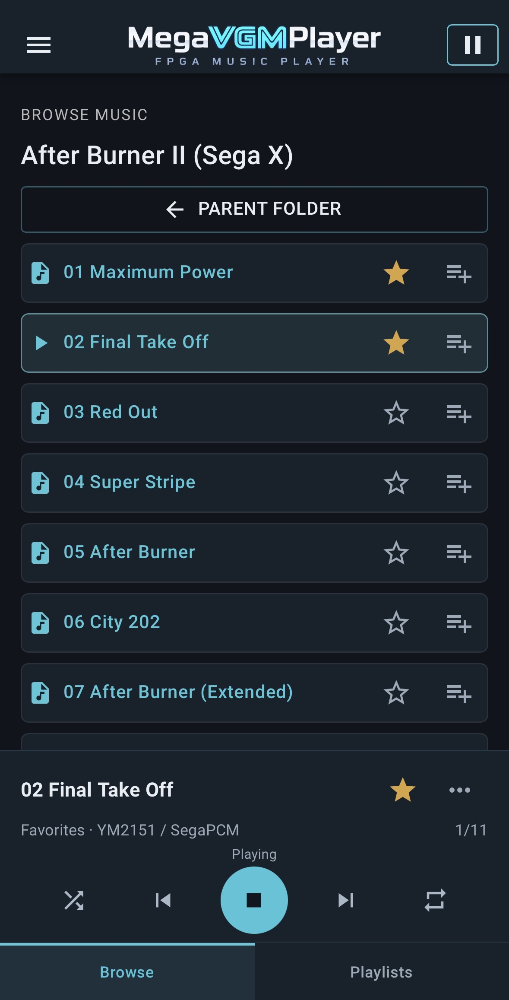
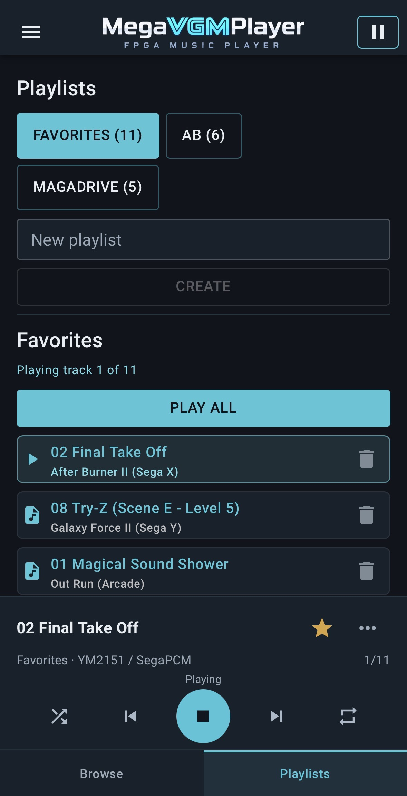

# MegaVGMPlayer

MiSTer向け FPGA Music Player

[English](README.md) · [MegaVGMPlayer v2.3](https://github.com/dai-VGM/MegaVGMDrive/releases/tag/v2.3) · [ZIP checksum](https://github.com/dai-VGM/MegaVGMDrive/releases/download/v2.3/MegaVGMPlayer-v2.3.zip.sha256)

MegaVGMDriveはFPGA/core開発プロジェクトのリポジトリ名です。ユーザー向け製品名はMegaVGMPlayerです。

## MegaVGMPlayer v2.3

MegaVGMPlayer v2.3は現在のproduction releaseです。独立したbrowser/PWA player、4種類の自動選択FPGA sound engine、Playlist、Favorites、transport control、raw SIDの統合prepare機能を提供します。

通常のユーザーがA/B/C/D RBFを手動選択する必要はありません。MegaVGMPlayerが各trackを分類して必要なFPGA sound engineを自動loadし、異なるengineが混在するPlaylist内でも自動切替します。

### v2.3の変更点

- Namco C140再生用のEngine Dを追加しました。C140＋YM2151のtrackにも対応し、A/B/C/Dを自動切替します。
- 透明INFO表示とloading表示を追加しました。
- Engine BのStage 6再生に関わるADPCM-A active bank処理を修正し、FM activity表示を6chへ拡張しました。
- 再生中の同じtrackを選択すると、先頭から再スタートします。
- 一部のMega Drive VGMで欠落しているSN76489 clockを、importerのprepare時に補正します。元fileは保持します。該当trackは元fileから、同梱のimporter/classifierの組で再importしてください。

### Gallery

| Browse | Playlists |
| --- | --- |
|  |  |

## Features

- 独立daemon `megavgm_remote`が提供するRemote/PWA Player
- phone、tablet、desktop browserからMegaVGMDrive libraryをBrowse
- PlaylistsとFavorites
- Previous、Next、Stop
- Repeat OneとRepeat Context
- Shuffleとautomatic next
- track/engine間のtransition fade
- A/B/C/D RBFの自動切替とmixed-engine Playlist
- Playlist完了時またはPlayer終了時にstock MiSTerを自動復元
- raw `.sid`を直接選択し、自動prepareとcache再利用
- track単位のoptional manual SID loop metadata
- 再生中の同じtrackを選択して先頭から再スタート
- 透明INFO/loading表示
- Engine別OSD activity表示と共通PLAY/LOAD/STOP badge

Pauseとseek/progress barは現在未実装です。

## Sound engines

| Engine | Sound hardware | Production RBF |
| --- | --- | --- |
| A | YM2612、SN76489 PSG、YM2151、YM2203、SegaPCM | `MegaVGMDrive_A.rbf` |
| B | YM2610、YM2610B | `MegaVGMDrive_B.rbf` |
| C | SID 6581/8580、PAL/NTSC timing | `MegaVGMDrive_C.rbf` |
| D | Namco C140（System 2/System 21）、optional YM2151 | `MegaVGMDrive_D.rbf` |

4本のRBFはすべて`MegaVGMDrive`というcore identityを公開します。Host classifierとSupervisorが自動的に選択・切替し、ファイル名は別editionではなくdeployment profileを表します。

## SID playback

raw `.sid` fileはMegaVGMPlayerから直接選択できます。ただし、FPGAが元のSID programを直接実行するわけではありません。

再生時にMiSTer側toolingが自動でprepareを行い、SID register-write streamをPacked MVGMSID v2へ変換・検証してSID cacheへ保存します。Engine CはFPGA上で、このprepared event streamを再生します。後続再生ではvalidなcacheを再利用します。

- ユーザーによる事前の手動変換は不要です。
- prepare処理はMegaVGMPlayerのplayback flowへ統合されています。
- standalone SID converterは現在配布していません。
- SID 6581/8580 modelとPAL/NTSC timingに対応します。
- prepared SID dataのproduction capacityは8 MiBです。
- optionalな`MegaVGMPlayer-SID-loop-v1` sidecarで、信頼できるtrack単位manual loopを指定できます。
- loop pointの自動検出は行いません。

SID互換性はsource tune、metadata、選択subtune、timing/model情報、および現在のsingle-SID prepare対応範囲に依存します。

## Installation

### 簡単なインストール（SDカードへコピー）

通常の利用にSSH、root shell、コマンドラインでの設定は不要です。パソコンのファイルマネージャーでリリースファイルをコピーできます。初回だけ、下記の通り付属の起動blockをテキストエディタで追記してください。ZIPには設定済みの`linux/user-startup.sh`は含まれていません。

1. [MegaVGMPlayer-v2.3.zip](https://github.com/dai-VGM/MegaVGMDrive/releases/download/v2.3/MegaVGMPlayer-v2.3.zip)をダウンロードして展開します。
2. 更新時はMegaVGMPlayerをSTOCK modeへ戻し、開いているPlayerのブラウザー／PWAタブを閉じます。SDカードを取り外す前にMiSTerの電源を切ってください。
3. **`MegaVGMPlayer-v2.3/media/fat/`の中身をすべて、MiSTer SDカードのルートへ**、フォルダー構造を保ってコピーします。更新時はフォルダーを結合し、既存のMegaVGMPlayerリリースファイルを置き換えてください。外側の`MegaVGMPlayer-v2.3`、`media`、`fat`フォルダー自体をSDカードへ追加するわけではありません。
4. 初回でMegaVGMPlayerの起動blockがまだない場合は、SDカード上の`linux/user-startup.sh`をテキストエディタで開き、展開したpackageの`startup.block`の内容をそのまま全体追記します。ファイルがなければ、先頭行を`#!/bin/sh`として、その後にblockを置いて新規作成してください。既存の起動設定は残します。更新時にこのblockが既にある場合は、そのまま保持して重複追加しないでください。
5. SDカードを戻してMiSTerを通常通り起動します。ブラウザーで`http://<MiSTer-IP>:8183/megavgm`を開くか、PWAとしてインストールし、通常通り再生を開始します。

コピー先は次の通りです。

| 展開したZIP内のフォルダー | MiSTer SDカード上のフォルダー | MiSTer Linux上のpath |
| --- | --- | --- |
| `media/fat/_Custom Cores/Cores/` | `_Custom Cores/Cores/` | `/media/fat/_Custom Cores/Cores/` |
| `media/fat/MegaVGMPlayer/` | `MegaVGMPlayer/` | `/media/fat/MegaVGMPlayer/` |
| `media/fat/Scripts/` | `Scripts/` | `/media/fat/Scripts/` |

RBFやruntimeなど一部のcomponentだけを差し替えず、**リリース一式をまとめてコピー**してください。RBF、modified Main、runtime binary、helperは組み合わせて検証されているため、異なるリリースのcomponentを混在させると再生やEngine切替が正常に動かなくなる可能性があります。既存フォルダーを削除せず結合し、音楽、Playlist／Favorites、legacy rescue RBF、`Scripts/remote.sh`は保持してください。

### 任意のchecksum確認

コピー前にZIPを検証する場合は、[MegaVGMPlayer-v2.3.zip.sha256](https://github.com/dai-VGM/MegaVGMDrive/releases/download/v2.3/MegaVGMPlayer-v2.3.zip.sha256)もダウンロードしてください。final v2.3 ZIPのSHA-256は次の通りです。

```text
b33397b2868a11ea83a99614d003429bcde7dfa70a2dcdb6ef712e7fcc34c61b
```

パソコン上でコマンドラインによる確認を行う場合:

```sh
sha256sum -c MegaVGMPlayer-v2.3.zip.sha256
# macOSの場合
shasum -a 256 -c MegaVGMPlayer-v2.3.zip.sha256
```

### Advanced: 任意のtransactional installer

installer scriptは任意の選択肢です。hash検証、backup、rollbackを伴うtransactionalなinstall／upgradeを利用したい方向けに用意されています。既存設定を保持しながら起動blockも追加します。この方法を使う場合は、ZIPを検証して展開し、MegaVGMPlayerをSTOCK modeへ戻してPlayerのブラウザー／PWAタブを閉じ、展開したpackageをMiSTerへコピーして`root`で`sh install.sh`を実行してください。その後MiSTerを再起動し、上記のPlayer URLを開きます。

既存installの更新では`upgrade.sh`が同じtransactional installation pathを使用します。`rollback.sh`でupgrade前に退避したfileを復元できます。installerはlegacy rescue RBFを保持し、置換対象fileをrollback用にbackupします。`/media/fat/Scripts/remote.sh`やPlaylist/Favorites dataを変更しません。installerが表示したbackup pathを保管してください。SDカードへの手動コピーではinstaller用のrollback checkpointは作成されません。

standalone playerはMiSTer Remoteと共存します。通常、MiSTer Remoteはport 8182のままで、MegaVGMPlayerはport 8183を使用します。

## Production paths

| 用途 | Path |
| --- | --- |
| Engine A RBF | `/media/fat/_Custom Cores/Cores/MegaVGMDrive_A.rbf` |
| Engine B RBF | `/media/fat/_Custom Cores/Cores/MegaVGMDrive_B.rbf` |
| Engine C RBF | `/media/fat/_Custom Cores/Cores/MegaVGMDrive_C.rbf` |
| Engine D RBF | `/media/fat/_Custom Cores/Cores/MegaVGMDrive_D.rbf` |
| Runtime binaryとasset | `/media/fat/MegaVGMPlayer/` |
| MegaVGMPlayer Main | `/media/fat/MegaVGMPlayer/MiSTer.megavgm` |
| Supervisor | `/media/fat/MegaVGMPlayer/megavgm_supervisor` |
| Controller | `/media/fat/MegaVGMPlayer/megavgm_playlist-phase2a` |
| SID preparer | `/media/fat/MegaVGMPlayer/megavgm_sid_prepare` |
| Standalone Remote/PWA daemon | `/media/fat/MegaVGMPlayer/megavgm_remote` |
| Scriptsとimporter | `/media/fat/Scripts/` |
| VGM/SID library root | `/media/fat/MegaVGMDrive/` |
| PlaylistsとFavorites | `/media/fat/Scripts/.config/megavgm/playlists.json` |
| Prepared SID cache | `/media/fat/MegaVGMPlayer/cache/sid/` |

v2.3 Playerは既存の`/media/fat/MegaVGMDrive/` libraryとの互換性を維持しています。

## Musicの追加

### VGM

1. `.vgm`、`.vgz`、`.zip`を`/media/fat/MegaVGMDrive/_inbox/`へcopyします。
2. MiSTer Scripts menuから`Scripts -> vgm_md_import`を実行します。

importerが対応archiveを展開し、library root配下へ整理します。FPGAが`.vgz`や`.zip`を直接展開するわけではありません。

### SID

raw `.sid`を`/media/fat/MegaVGMDrive/`配下、例えば`SID` directoryへ配置します。BrowseまたはPlaylistから通常通り選択してください。必要に応じてMegaVGMPlayerが内部Packed MVGMSID v2 streamをprepareし、cacheします。

## PlayerとPlaylists

次のURLを開きます。

```text
http://<MiSTer-IP>:8183/megavgm
```

Browseにはlibrary root配下の対応VGM/SID contentが表示されます。PlaylistsとFavoritesでは、raw `.sid`を含むユーザーが選んだsource pathをtrack identityとして維持し、内部prepared-cache pathを表示しません。

Previous、Next、Stop、Repeat One、Repeat Context、Shuffle、automatic nextを利用できます。Playlistが異なるsound hardware familyを跨いでも、MegaVGMPlayerがEngine A/B/C/Dを自動切替します。

## Architecture

```text
Browser / installed PWA (:8183)
    -> megavgm_remote
    -> Supervisor
    -> Phase2A controller
    -> MiSTer.megavgm + 自動選択されたEngine A/B/C/D RBF
```

MegaVGMPlayerは内部で複数のFPGA sound-engine RBFを使用します。Host classifierが必要profileを選択し、Supervisorが検証済みMain/coreの置換、controller起動、transition policy、stock MiSTerの復元を担当します。通常のユーザーがRBF transitionを管理する必要はありません。

MiSTer Remoteは独立した別serviceであり、このrequest pathの依存先ではありません。

## OSD activity views

v2.3 RBFは、既存engine signalから得た軽量activity indicatorを表示します。audio levelやVU meterではありません。

- **Engine A:** YM2612、PSG、YM2151、SegaPCM、YM2203のsource activity。
- **Engine B:** FM 1–6、SSG A–C、ADPCM-A 1–6、ADPCM-Bの計16 activity block。
- **Engine C:** SID Voice 1–3とD418 register-write activityの6-frame history、および6581/8580 modelとPAL/NTSC timing。
- **Engine D:** YM2151のchannel activityとC140のvoice activity。
- **全Engine共通:** 右下のPLAY/LOAD/STOP badge。

## Limitations

- Pauseとseek/progress barは未実装です。
- C219（ASIC219）、dual C140、未知のC140 variantには対応していません。
- Mega CD / RF5C164と32X PWMの再生には対応していません。
- Engine Cは現在single SID streamをprepareして再生します。Tune固有metadataや未対応SID構成により再生できない場合があります。
- manual SID loop metadataはoptionalで、信頼できるtrack単位sidecarから与える必要があります。
- MegaVGMPlayerはmusic playerであり、完全なconsole、arcade machine、C64実装ではありません。

## Troubleshooting

- UIが開かない場合は、`megavgm_remote`が稼働しport 8183へ到達できることを確認してください。
- trackをloadできない場合は、必要なA/B/C/D RBFが上記のexact production pathに存在することを確認してください。
- raw SIDのprepareが必要な場合、初回再生はcache hitより大幅に時間がかかります。後続再生はvalidなprepared cacheを再利用します。
- installが中断された場合はinstallerを再実行するか`rollback.sh`を使用し、異なるreleaseのruntime binaryを手動混在させないでください。

## Older releases

- **[v2.2](https://github.com/dai-VGM/MegaVGMDrive/releases/tag/v2.2)** でEngine C、raw SIDの統合prepare、A/B/C自動切替を導入しました。
- **v2.1 “Independence Day”** でport 8183のstandalone daemonとA/B自動切替を導入しました。
- **v2.0** はport 8182のmodified MiSTer Remote integrationを使用していました。
- **v1.x** は歴史資料としてのみ残しています: [v1.0.2](https://github.com/dai-VGM/MegaVGMDrive/releases/tag/v1.0.2)、旧[YM2610B beta](https://github.com/dai-VGM/MegaVGMDrive/releases/tag/YM2610B_Beta)。

現在のinstallには[v2.3](https://github.com/dai-VGM/MegaVGMDrive/releases/tag/v2.3)を使用してください。

## Repository

MegaVGMDriveには、MegaVGMPlayerを構成するFPGA/core source、host tooling、player integration、tests、release documentationが含まれます。

source-derived licenseとprovenanceはrepositoryおよびv2.3 release packageに記録されています。binaryや派生sourceを再配布する前に、source headerと同梱provenance documentを確認してください。

## Development note

このプロジェクトのほぼすべては、プロジェクト所有者の指示のもと、OpenAI CodexおよびGPTによって実装・debugされました。

## Acknowledgements

- [MiSTer-devel/Genesis_MiSTer](https://github.com/MiSTer-devel/Genesis_MiSTer)
- [Jotego jtcores](https://github.com/jotego/jtcores)
- [JTOUTRUN](https://github.com/jotego/jtcores/tree/master/cores/outrun) SegaPCM RTL
- MiSTer FPGA community、VGM preservation community

## License

MegaVGMDriveにはoriginal codeと、それぞれ固有のlicense条件を持つsource-derived componentが含まれます。詳細はsource headerとrepositoryのprovenance documentを参照してください。
