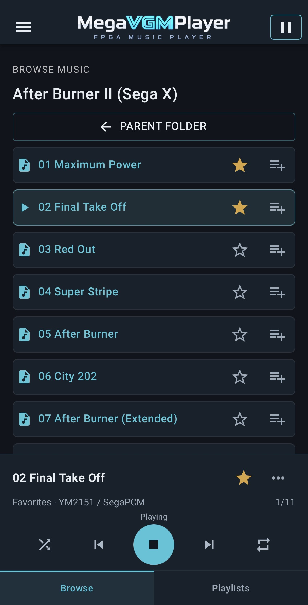
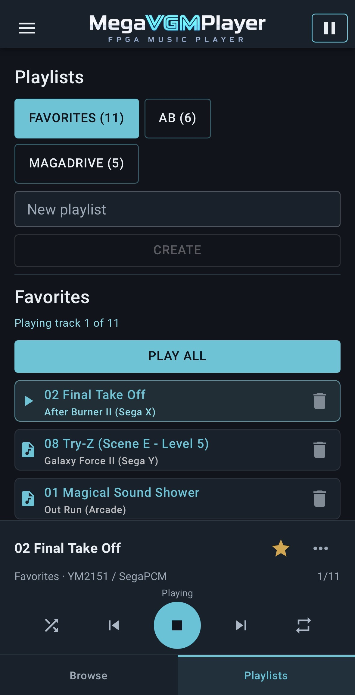

# MegaVGMPlayer

MiSTerでゲーム音楽を楽しむプレイヤーです。スマホやPCのブラウザーで選曲でき、曲に合わせて7種類のFPGA音源が自動で切り替わります。お気に入りやプレイリストも作れます。

[English](README.md) · [v2.6 リリースノート](https://github.com/dai-VGM/MegaVGMDrive/releases/tag/v2.6) · [SHA256一覧](https://github.com/dai-VGM/MegaVGMDrive/releases/download/v2.6/SHA256SUMS.txt)

## v2.6のインストール

標準MiSTerとSS1 Console Modeで動作を確認しています。

1. [MegaVGMPlayer-v2.6-Full-Install.zip](https://github.com/dai-VGM/MegaVGMDrive/releases/download/v2.6/MegaVGMPlayer-v2.6-Full-Install.zip) をダウンロードして解凍し、中身をSDカードのルートにコピー。
2. MiSTerの `Scripts → MegaVGMPlayer_Full_Setup` を実行。
3. ブラウザーで [http://mister.local:8183/megavgm](http://mister.local:8183/megavgm) を開きます。つながらない場合は `mister.local` をMiSTerのIPアドレスに置き換えてください。

**v2.5から更新する場合**は、SDカードをバックアップし、通常Menuに戻ってからSetupを実行してください。v2.5のプレイヤーを開いていた場合は一度閉じ、Setup後に同じURLを開き直してください。

Menuに戻るにはプレイヤーの `Full Exit` を選びます。Setupが途中で止まった場合はScriptsから `MegaVGMPlayer_Full_Recovery`、v2.6を削除して元のv2.5に戻す場合は `MegaVGMPlayer_Full_Uninstall` を実行します。

## 再生について

- VGM・VGZ・NSF・NSFe・SIDを再生できます。対応音源やファイル形式には制限があります。
- ブラウザーからお気に入りやプレイリストを使えます。シャッフルやリピートにも対応しています。
- 一部のNES VGM/VGZは未対応です。
- SIDは初回再生時にMiSTer上で事前変換します。曲長情報がない場合やCPU負荷が高い環境では、変換が120秒の制限を超えて再生に失敗することがあります。変換済みキャッシュがあれば再利用します。SIDの曲名はHDMIのOSDに表示されません。
- NAS全般の動作は未検証です。

### 音源エンジン

| Engine | 担当する音源・楽曲 |
| --- | --- |
| A | メガドライブやアーケード向け。YM2612、SN76489、YM2151、YM2203、SegaPCM、K053260。 |
| B | ネオジオやアーケード向け。YM2610／YM2610B。 |
| C | Commodore 64のSID楽曲。6581／8580、PAL／NTSCに対応。 |
| D | アーケード向け。ナムコC140やOKI MSM6295のPCM系音源と、YM2151のFM音源。 |
| E | ファミコン／NESのAPUと、VRC6・VRC7・FDSなどの拡張音源。NSF・NSFeと一部のNES VGM/VGZに対応。 |
| F | PCエンジン／TurboGrafx-16向け。HuC6280 PSG。 |
| G | コナミのアーケード向け。YM2151とK053260。 |

### 画面イメージ

| Browse | Playlists |
| --- | --- |
|  |  |

## ソースと旧バージョン

MegaVGMDriveはMegaVGMPlayerのFPGAコア開発プロジェクトです。[v2.6リリース](https://github.com/dai-VGM/MegaVGMDrive/releases/tag/v2.6) に対応ソース、ビルドに必要なファイル、ライセンス表示を掲載しています。旧版は[リリース一覧](https://github.com/dai-VGM/MegaVGMDrive/releases)から入手できます。

## Development note

このプロジェクトのほぼすべては、プロジェクト所有者の指示のもと、OpenAI CodexおよびGPTによって実装・debugされました。

## Acknowledgements

- [MiSTer-devel/Genesis_MiSTer](https://github.com/MiSTer-devel/Genesis_MiSTer)
- [Jotego jtcores](https://github.com/jotego/jtcores)
- [JTOUTRUN](https://github.com/jotego/jtcores/tree/master/cores/outrun) SegaPCM RTL
- MiSTer FPGA community、VGM preservation community

## License

MegaVGMDriveにはoriginal codeと、それぞれ固有のlicense条件を持つsource-derived componentが含まれます。詳細はsource headerとrepositoryのprovenance documentを参照してください。
