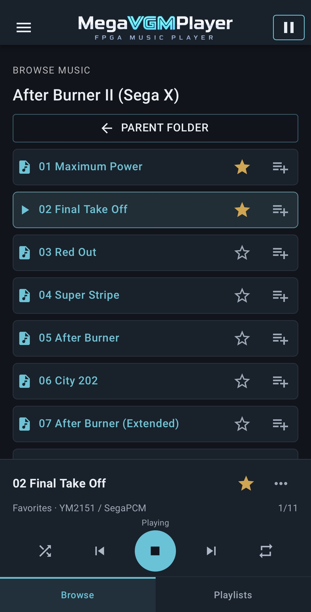
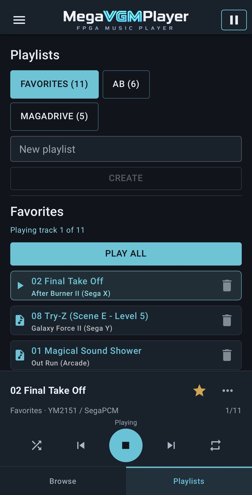

# MegaVGMPlayer

Play game music on your MiSTer from a phone, tablet, or computer. MegaVGMPlayer automatically switches between seven FPGA sound engines as you play. Browse your library, save favorites, and build playlists in your browser.

[日本語](README.ja.md) · [v2.6 release notes](https://github.com/dai-VGM/MegaVGMDrive/releases/tag/v2.6) · [SHA256 checksums](https://github.com/dai-VGM/MegaVGMDrive/releases/download/v2.6/SHA256SUMS.txt)

## Install v2.6

Tested on standard MiSTer and SS1 Console Mode.

1. Download and unzip [MegaVGMPlayer-v2.6-Full-Install.zip](https://github.com/dai-VGM/MegaVGMDrive/releases/download/v2.6/MegaVGMPlayer-v2.6-Full-Install.zip). Copy the extracted contents to the root of your MiSTer SD card.
2. On MiSTer, run `Scripts → MegaVGMPlayer_Full_Setup`. Setup takes a little while. When you see `Installing... Please wait.`, wait for `Full ready`.
3. Open [http://mister.local:8183/megavgm](http://mister.local:8183/megavgm) in your browser. If it doesn’t connect, replace `mister.local` with your MiSTer’s IP address.

**Upgrading from v2.5?** Back up your SD card and return to the regular Menu before running Setup. Close the v2.5 player tab and reopen the same URL after setup.

Use `Full Exit` in the player to return to the MiSTer Menu. If setup was interrupted, run `MegaVGMPlayer_Full_Recovery` from Scripts. To remove v2.6 and restore a previous v2.5 installation, run `MegaVGMPlayer_Full_Uninstall`.

## Playback

- Supports VGM, VGZ, NSF, NSFe, and SID within the supported sound hardware and formats.
- Favorites, playlists, shuffle, and repeat work from the browser player.
- Some NES VGM/VGZ files are unsupported.
- SID files are converted on the MiSTer before first playback. If song length information is missing or the CPU is busy, conversion can exceed the 120-second limit and playback may fail. Later plays reuse a valid cached conversion. SID titles aren’t shown on the HDMI OSD.
- General NAS compatibility is untested.

### Sound engines

MegaVGMPlayer uses Jotego’s FPGA FM cores, including JT12 for the YM2612 and JT51 for the YM2151, for faithful reproduction of the original chips. Engine B’s YM2610 and YM2610B support is based on Jotego’s JT10/JT12 design.

| Engine | What it plays | Audio RTL credits |
| --- | --- | --- |
| A | Mega Drive and arcade music using YM2612, SN76489, YM2151, YM2203, SegaPCM, and K053260. | Jotego’s [JT12 / JT03](https://github.com/jotego/jt12) for YM2612 / YM2203 FM, [JT51](https://github.com/jotego/jt51) for YM2151, [JT49](https://github.com/jotego/jt49) for SSG, and [JT89](https://github.com/jotego/jt89) for SN76489. |
| B | Arcade and Neo Geo music using YM2610 or YM2610B. | Based on Jotego’s [JT10 / JT12](https://github.com/jotego/jt12) for YM2610 and YM2610B, with [JT49](https://github.com/jotego/jt49) for SSG. |
| C | Commodore 64 SID music for the 6581 and 8580, with PAL and NTSC timing. | SID RTL adapted from [C64_MiSTer](https://github.com/MiSTer-devel/C64_MiSTer/tree/fe6dfe53c99122e5a088691f2d358d6caba61de1/rtl/sid). The DAC and filter build on Dag Lem’s [reDIP-SID](https://github.com/daglem/reDIP-SID), with filter adaptation by Alexey Melnikov. |
| D | Arcade music using Namco C140 or OKI MSM6295, with YM2151 for FM. | Jotego’s [JT51](https://github.com/jotego/jt51) for YM2151. C140 and MSM6295 are MegaVGMPlayer implementations. |
| E | Famicom/NES APU and expansion audio such as VRC6, VRC7, and FDS. Plays NSF/NSFe and supported NES VGM/VGZ tracks. | NES APU and FDS from [NES_MiSTer](https://github.com/MiSTer-devel/NES_MiSTer/tree/49a0a662e244469ca77b2155746a066df704ffae/rtl) (Kitrinx, with Loopy’s FDS research). Sunsoft 5B draws on NES_MiSTer and Jotego’s [JT49](https://github.com/jotego/jt49). VRC7 uses Raki (Sehyeon Kim)’s [IKAOPLL](https://github.com/ika-musume/IKAOPLL/tree/15b373be57b52b4e3eb9b99653dabc5095f7a644), which uses VRC7 patch data and a digital output design from Nuke.YKT’s [Nuked-SMS-FPGA](https://github.com/nukeykt/Nuked-SMS-FPGA/tree/4d52fb01b15bef693ead7b3b787b55f4202877d5). |
| F | PC Engine/TurboGrafx-16 music using the HuC6280 PSG. | MegaVGMPlayer’s HuC6280 PSG, checked against [Mednafen’s PCE PSG](https://github.com/libretro/beetle-pce-libretro/blob/b96c11e095b6a40a412d2da02766ae1c3f4fd539/mednafen/hw_sound/pce_psg/pce_psg.cpp). |
| G | Konami arcade music using YM2151 and K053260. | Jotego’s [JT51](https://github.com/jotego/jt51) for YM2151. K053260 is a MegaVGMPlayer implementation. |

The [v2.6 corresponding source archive](https://github.com/dai-VGM/MegaVGMDrive/releases/download/v2.6/MegaVGMPlayer-v2.6-Corresponding-Source.zip) includes the build inputs and source notices.

### Gallery

| Browse | Playlists |
| --- | --- |
|  |  |

## Source and older releases

MegaVGMDrive is the FPGA/core project behind MegaVGMPlayer. The [v2.6 release](https://github.com/dai-VGM/MegaVGMDrive/releases/tag/v2.6) includes the corresponding source, build inputs, and license notices. Earlier versions are in the [release archive](https://github.com/dai-VGM/MegaVGMDrive/releases).

## Development note

Almost all of this project was implemented and debugged by OpenAI Codex and GPT, guided by the project owner.

## Acknowledgements

- [MiSTer-devel/Genesis_MiSTer](https://github.com/MiSTer-devel/Genesis_MiSTer)
- [Jotego jtcores](https://github.com/jotego/jtcores)
- [JTOUTRUN](https://github.com/jotego/jtcores/tree/master/cores/outrun) SegaPCM reference for earlier versions and comparison tests
- The MiSTer FPGA community and VGM preservation community

## License

MegaVGMDrive contains original code and source-derived components with their own license terms. Refer to source headers and repository provenance documents for details.
